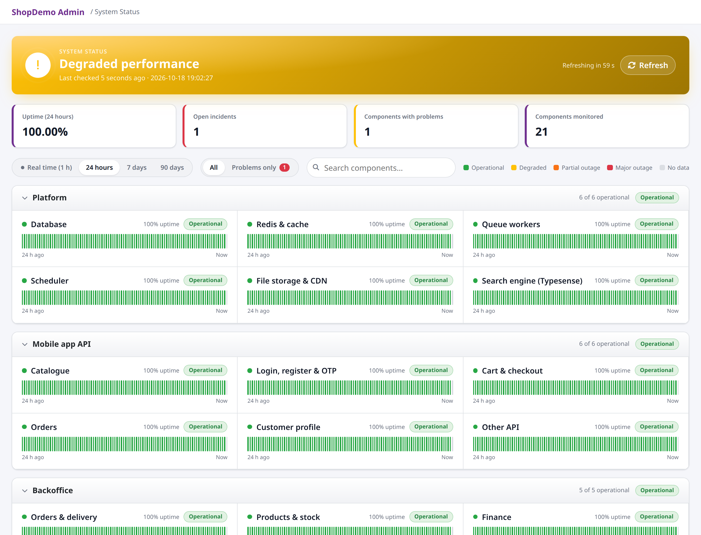
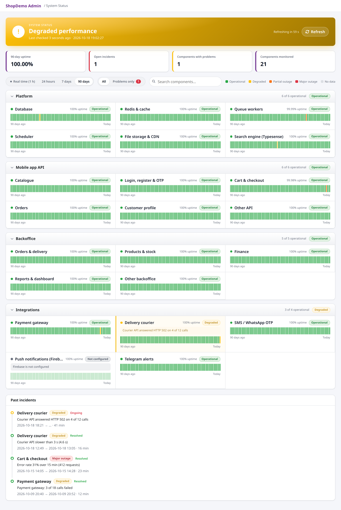
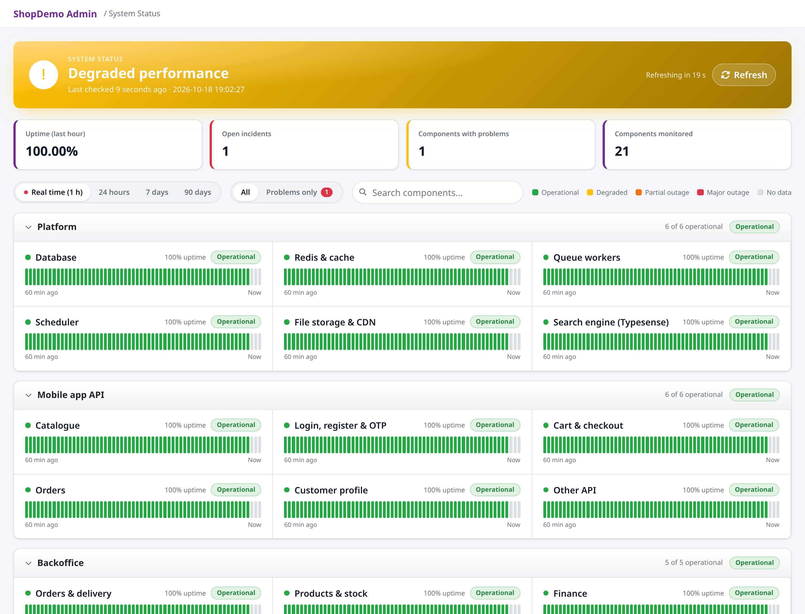
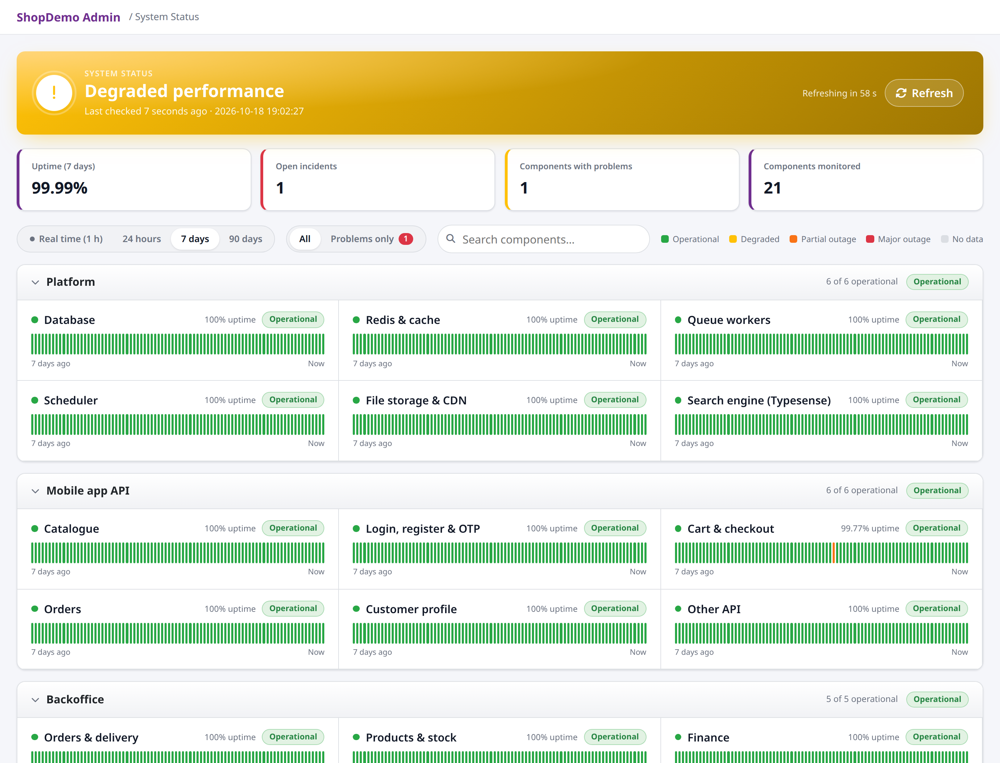
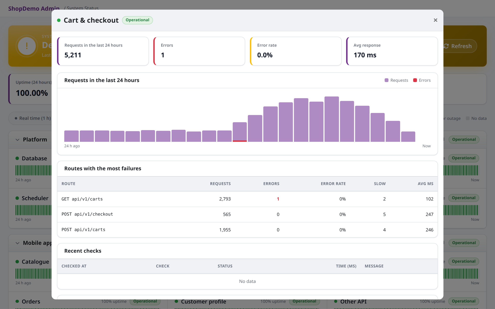
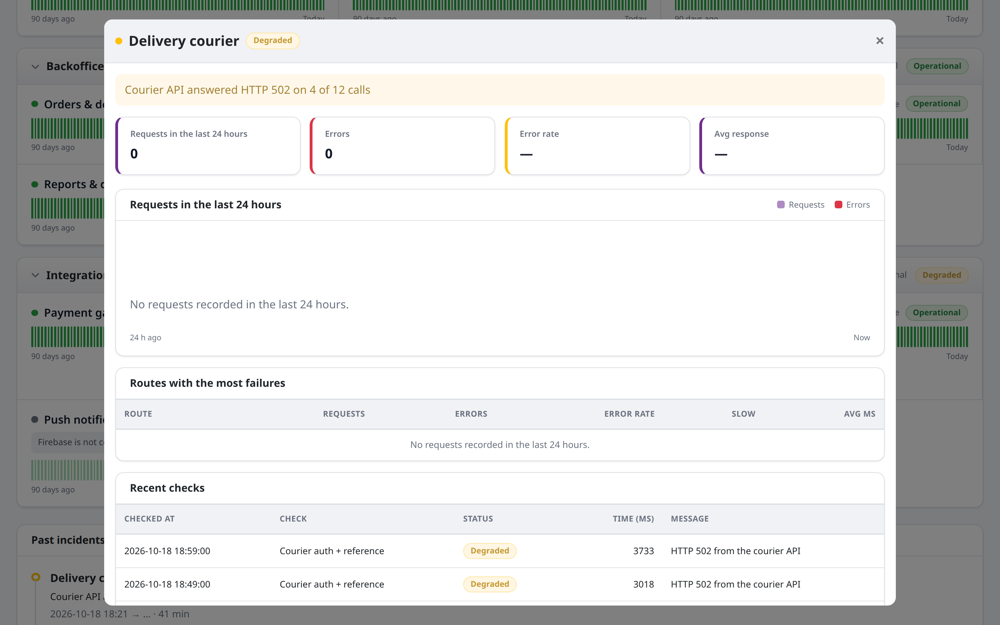
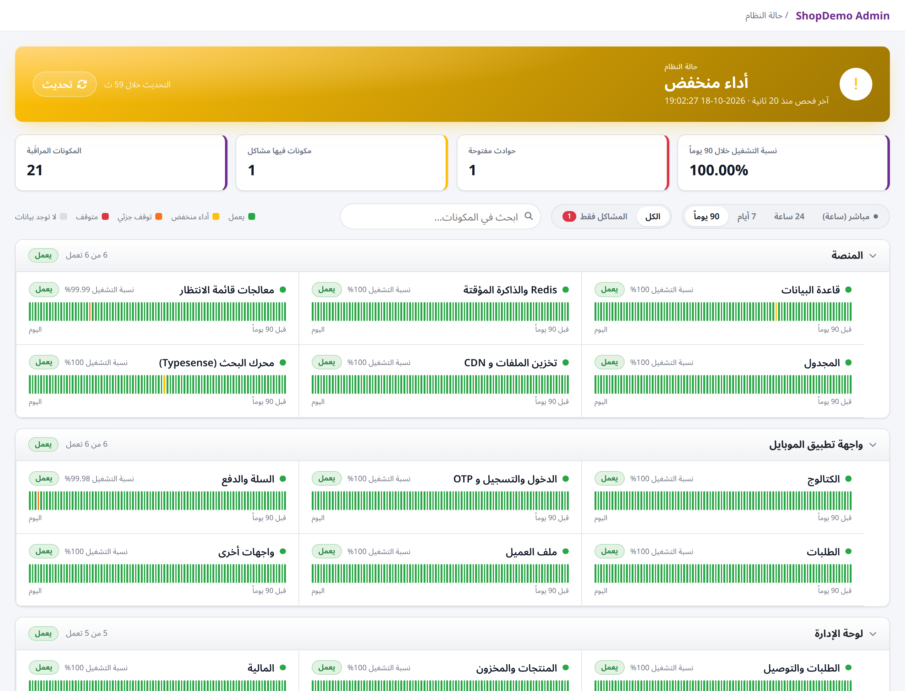
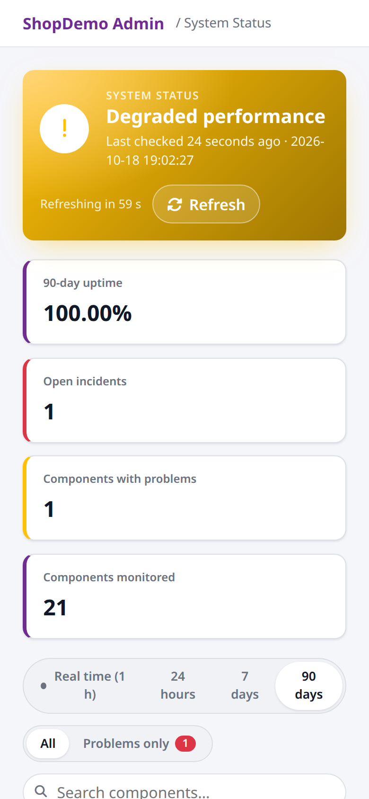

# Laravel System Status

[](https://packagist.org/packages/technobase/laravel-system-status)
[](https://packagist.org/packages/technobase/laravel-system-status)
[](https://packagist.org/packages/technobase/laravel-system-status)
[](LICENSE)

`technobase/laravel-system-status` adds a live status page to a Laravel backoffice, in the
style of githubstatus.com. It shows whether every part of the application works (database,
queues, APIs, backoffice screens, payment and delivery integrations), keeps 90 days of
history, opens incidents by itself and alerts you on Telegram, mail, Slack or Discord.



- **Probes**: small read-only checks that run every few minutes (database, Redis, Horizon,
  queues, HTTP endpoints, CDN, TLS certificates, disk space, DNS, TCP ports, Telegram, and your
  own integrations).
- **Real traffic**: every request is counted per component and route; 5xx responses are
  failures, and slow p95 response times can count too.
- **Signals**: one line around calls that cost money or have side effects (SMS, OTP, social
  login, paid AI APIs) reports whether they worked.
- **No false alarms**: a status changes only after two checks in a row agree, flapping
  components send one alert, and a component that fails because of another one is folded into
  that one's alert.
- **Incidents**: opened and resolved by the checks, or posted by hand with a timeline
  (Investigating, Identified, Monitoring, Resolved) and a postmortem.
- **Maintenance windows**: planned work shows *Maintenance*, raises no alert and does not count
  against uptime.
- **Suspicious activity** (opt-in): attack patterns per IP (denied requests, scanners looking
  for `.env` or `wp-admin`, rate-limited clients), login abuse, logins from a new country, SMS /
  OTP budget abuse, risky actions such as role changes or mass exports, and dangerous settings
  like `APP_DEBUG` in production.
- **Alerts**: Telegram, mail, Slack, Discord and signed webhooks, plus Laravel events you can
  listen to.
- **SLA and reports**: monthly uptime per component against a target, as a page, CSV or PDF.
- **History**: real time (1 hour), 24 hours, 7 days and 90 days.
- **Languages**: English, Arabic and Sorani Kurdish, right-to-left included.

Used in production by Khatun-Ecommerce and CloudNova-OnlineShopping.

---

## Contents

- [Screenshots](#screenshots)
- [How it works](#how-it-works)
- [Requirements](#requirements)
- [Installation](#installation)
- [Integrating it into an application](#integrating-it-into-an-application)
- [Configuration reference](#configuration-reference)
- [Probes](#probes)
- [Signals](#signals)
- [Maintenance windows](#maintenance-windows)
- [Incidents](#incidents)
- [Deploy markers](#deploy-markers)
- [Suspicious activity](#suspicious-activity)
- [Alerts](#alerts)
- [Latency](#latency)
- [Dependencies](#dependencies)
- [SLA and reports](#sla-and-reports)
- [Reacting to status changes](#reacting-to-status-changes)
- [Access](#access)
- [Pulse card](#pulse-card)
- [Look and feel](#look-and-feel)
- [Translations](#translations)
- [Commands and schedule](#commands-and-schedule)
- [Database tables](#database-tables)
- [Claude Code skill](#claude-code-skill)
- [Deployment](#deployment)
- [Troubleshooting](#troubleshooting)
- [Upgrading and releases](#upgrading-and-releases)
- [Contributing](#contributing)
- [License](#license)

---

## Screenshots

**The whole page** (90 days): banner, key numbers, every component with its history bars, and
past incidents.



**Time ranges**: real time (1 hour, one bar per minute), 24 hours and 7 days.

| Real time (1 hour) | 7 days |
| --- | --- |
|  |  |

**Component details**: requests and errors per hour, the routes with the most failures and the
latest checks. Click any component name.

| Healthy component | Component with an ongoing problem |
| --- | --- |
|  |  |

**Arabic (right to left)** and **phone**:

| Arabic | Phone |
| --- | --- |
|  |  |

The screenshots come from a demo shop with sample data.

---

## How it works

```
                 every minute                              every request
  scheduler ──▶ status:check ◀── Redis counters ◀── RecordRouteHealth middleware
                    │   ▲
                    │   └── StatusSignal::success() / failure()   (your code)
                    ▼
  probes, traffic, signals, manual incidents ──▶ worst source wins
                                                      │
                     in a maintenance window? ── yes ─┼─▶ "Maintenance" (no incident, no alert)
                                                      ▼
                        depends_on failing too? ──▶ "Affected by …" (alert folded into it)
                                                      │
                                       2 runs agree? ──▶ status changes
                                                      │
       incidents · daily and monthly history · alerts (Telegram, mail, Slack, Discord, webhooks) · events
                                                      │
                               page /system-status ◀──┘  (refreshes itself)
```

1. You describe your application as **components** in groups (for example *Platform*,
   *Mobile API*, *Backoffice*, *Integrations*) in `config/system-status.php`.
2. Each component gets its status from its sources, and **the worst one wins**:
   - its **probes**, run every `every` minutes by `status:check`;
   - its **routes**: real requests matched by route name or URI. Over the last 15 minutes an
     error rate of 5 % or more is *degraded*, 25 % or more is a *major outage*, as long as there
     were at least 20 requests. A slow p95 response time can count too (off by default, see
     [Latency](#latency));
   - its **signal**: success and failure reports from your code (at least 3 calls);
   - an open **manual incident**: it holds the component at its severity until someone resolves
     it.
3. A component inside a **maintenance window** shows *Maintenance* at once. It opens no incident
   and sends no alert, and the time does not count against uptime.
4. A failing component whose **dependency** (`depends_on`) fails too shows *Affected by …*, and
   its alert is folded into the dependency's.
5. A new status is **confirmed** only when two runs in a row agree, so one slow answer never
   pages anyone.
6. A confirmed change opens, upgrades or resolves an **incident**, sends one **alert** to the
   configured channels and webhooks, and fires `ComponentStatusChanged`.
7. The scheduler cannot report its own outage: the first run after a gap records a resolved
   scheduler incident for the gap, and the page shows the scheduler red while runs are late.

A component with no data yet shows **No data**, never a fake *Operational*. A probe that is not
configured (missing API key, integration turned off) shows **Not configured** and does not
count as a failure.

---

## Requirements

| | |
| --- | --- |
| PHP | 8.3 or newer |
| Laravel | 12 or 13 |
| Database | PostgreSQL, MySQL 8 / MariaDB, or SQLite |
| Redis | for the per-minute traffic counters (any connection; see `redis_connection`). Apps that share one Redis need different key prefixes (`REDIS_PREFIX` / `APP_NAME`), or they will read each other's traffic |
| Scheduler | `php artisan schedule:work` or a cron entry running `schedule:run` every minute |
| `spatie/laravel-health` | installed automatically; used for the database, Redis, cache and Horizon checks |
| Layout | none required: without a backoffice layout the page renders as its own full HTML page (see [Layout](#layout)) |
| Front end | Font Awesome 5 or 6 (the standalone page loads it). No jQuery or Bootstrap: the page script is plain JavaScript and the dialogs and forms use Tailwind from a CDN (`tailwind_cdn`) with prefixed `tw:` classes and no global reset, so your layout's own styles are not touched |

Optional:

- `spatie/laravel-permission`, for the default role check (or use a Gate, see [Access](#access));
- `laravel-notification-channels/telegram`, for Telegram alerts;
- `barryvdh/laravel-dompdf`, for the PDF version of the monthly report;
- `laravel/pulse`, for the [Pulse card](#pulse-card).

---

## Installation

Install the package from [Packagist](https://packagist.org/packages/technobase/laravel-system-status)
with Composer, publish the config and run the migrations:

```bash
composer require technobase/laravel-system-status
php artisan vendor:publish --tag=system-status-config
php artisan migrate
```

The service provider is discovered automatically. Out of the box it:

- registers the page at `/system-status` (route names `system_status.index`,
  `system_status.summary`, `system_status.component`, `system_status.report`, and the
  `system_status.incidents.*` / `system_status.maintenances.*` write routes) behind `web` +
  `auth` and the access check;
- adds the traffic middleware to every request;
- schedules `status:check` every minute and `status:prune` every day at 03:30 (and
  `status:report` monthly when `reports.mail_to` is set);
- registers the commands `status:check`, `status:prune`, `status:routes`, `status:maintenance`,
  `status:test-alert`, `status:report` and `status:doctor`.

Run `php artisan status:doctor` to check the setup, then open `/system-status` as a Super Admin.
Until the first `status:check` run the banner says *Waiting for the first status check*.

---

## Integrating it into an application

A complete integration takes five steps.

### 1. Describe your components

In `config/system-status.php`, list groups and components. A component needs at least one
source: probes, routes (`names` / `uris`) or a signal.

```php
use Spatie\Health\Checks\Checks\DatabaseCheck;
use Spatie\Health\Checks\Checks\HorizonCheck;
use Spatie\Health\Checks\Checks\RedisCheck;
use Technobase\SystemStatus\Probes\CdnStorageProbe;
use Technobase\SystemStatus\Probes\HttpEndpointProbe;
use Technobase\SystemStatus\Probes\QueueHeartbeatProbe;
use Technobase\SystemStatus\Probes\SpatieCheckProbe;

'groups' => [
    'platform' => [
        'database' => ['probes' => [['class' => SpatieCheckProbe::class, 'with' => ['check' => DatabaseCheck::class], 'every' => 1]]],
        'redis'    => ['probes' => [['class' => SpatieCheckProbe::class, 'with' => ['check' => RedisCheck::class], 'every' => 1]]],
        'queue'    => ['probes' => [
            ['class' => SpatieCheckProbe::class, 'with' => ['check' => HorizonCheck::class], 'every' => 1],
            ['class' => QueueHeartbeatProbe::class, 'every' => 1],
        ]],
        'scheduler' => [],   // decided by status:check itself
        'storage'  => ['probes' => [['class' => CdnStorageProbe::class, 'with' => ['disk' => 's3'], 'every' => 5]]],
    ],

    'mobile_api' => [
        'api_catalogue' => [
            'probes' => [['class' => HttpEndpointProbe::class, 'with' => ['path' => '/api/v1/categories'], 'every' => 2]],
            'uris' => ['api/v1/categories*', 'api/v1/products*'],
            'depends_on' => ['database'],
        ],
        'api_auth' => ['uris' => ['api/v1/auth*'], 'sla' => 99.9],
        'api_social_login' => ['uris' => ['api/v1/auth/social*'], 'signal' => true],
        'api_other' => [],
    ],

    'backoffice' => [
        'bo_orders' => ['uris' => ['order', 'order/*', 'orders/*']],
        'bo_other' => [],
    ],

    'integrations' => [
        'payments' => [
            'probes' => [['class' => App\Probes\PaymentGatewayProbe::class, 'every' => 10]],
            'uris' => ['api/v1/webhooks/payments*'],
        ],
        'sms_otp' => ['signal' => true],
    ],
],
```

How routes are matched:

- `names` (route-name patterns, e.g. `website.*`) are tried first, then `uris` (e.g.
  `api/v1/orders*`). `*` matches anything.
- **The longest matching pattern wins**, so `api/v1/auth/social*` beats `api/v1/auth*`.
- Unmatched routes go to `fallback`: `api/*` → `api_other`, everything else → `bo_other`.
- `ignore_uris` are not counted at all (Horizon, debug tools, health checks, this page).

Check the result:

```bash
php artisan status:routes --fallback          # routes that matched no component
php artisan status:routes --component=api_auth
php artisan status:doctor                     # the whole setup
```

### 2. Add probes for your integrations

For every external service that has a **free, read-only** call (a "verify key" endpoint, a
list of cities, an account lookup), write a probe. See [Probes](#probes).

### 3. Add signals where a call costs money or has side effects

SMS and OTP gateways, social login, paid AI APIs: wrap the existing call. See [Signals](#signals).

### 4. Name your components

Add labels for components the package does not know in every locale. See
[Translations](#translations).

```php
// lang/vendor/system-status/en/status.php
return [
    'status_component_payments' => 'Payment gateway',
    'status_component_sms_otp' => 'SMS / WhatsApp OTP',
];
```

### 5. Link it from the sidebar

```blade
@if(auth()->user()?->hasRole('Super Admin'))
    <li class="nav-item">
        <a href="{{ route('system_status.index') }}" class="nav-link {{ request()->is('system-status*') ? 'active' : '' }}">
            <i class="fa-solid fa-heart-pulse"></i>
            <span>@lang('system-status::status.system_status')</span>
        </a>
    </li>
@endif
```

Done. Run `php artisan status:check` once, open the page, and make sure the scheduler runs.

---

## Configuration reference

All options live in `config/system-status.php`.

| Key | Default | What it does |
| --- | --- | --- |
| `enabled` | `env('SYSTEM_STATUS_ENABLED', true)` | `SYSTEM_STATUS_ENABLED=false` turns the whole package off: no traffic counting, signals, schedule, `status:check` runs or alerts, and every package route answers 404 (route names stay, so links keep working). Migrations and commands still load |
| `path` | `system-status` | URL of the page; the data endpoints are `<path>/summary`, `<path>/components/{key}` and `<path>/reports/{YYYY-MM}.{html\|csv\|pdf}` |
| `middleware` | `['web', 'auth']` | middleware of the page routes (the access check is always added) |
| `access.roles` | `['Super Admin']` | roles allowed in, checked with `$user->hasRole()` |
| `access.gate` | `null` | a Gate ability name; when set, it replaces the role check |
| `access.manage_gate` | `null` | a Gate ability for posting incidents, updates and postmortems and for scheduling maintenance; `null` = everyone who can open the page |
| `layout` | `layouts.app` | Blade layout the page extends; `'standalone'` (or `null`, or a view that does not exist) = the package's own full page |
| `stacks.styles` / `.modals` / `.scripts` | `styles` / `modals` / `scripts` | stack names in that layout |
| `standalone.css` / `.js` | Font Awesome 6 from a CDN / none | assets of the standalone page; point them at local files for an offline server or a strict CSP |
| `tailwind_cdn` | `@tailwindcss/browser@4.3.3` on jsDelivr | the Tailwind script that styles the dialogs, slide-over panels and forms; point it at a local copy for an offline server or a strict CSP |
| `standalone.rtl_locales` | `ar`, `ku`, `ckb`, `fa`, `he`, `ur` | locales the standalone page shows right to left |
| `standalone.brand` | `TechnoBase` | name in the standalone page's top bar, browser title and description line |
| `standalone.back_url` | `null` (`/`) | where the back button goes when there is no previous page of the application |
| `extra_css` | `null` | absolute path of a CSS file added after the package styles |
| `incidents_per_page` | `10` | incidents in *Past incidents* at first and per *Show more* click (1–100) |
| `refresh_seconds` | `['1h' => 20, 'default' => 60]` | seconds between automatic refreshes, per range |
| `record_traffic` | `true` | count every request (global middleware) |
| `schedule` | `true` | schedule `status:check`, `status:prune` and (with `reports.mail_to`) the monthly `status:report` |
| `schedule_on_one_server` | `true` | run those scheduled commands on one server only (`onOneServer()`), so several servers do not double probes, incidents and alerts; skipped when the cache store cannot lock |
| `heartbeat_store` | `null` | cache store that keeps the outcome of the last runs (`null` = default store), so a failing `status:check` shows on the page; use a shared store on several servers |
| `redis_connection` | `null` | Redis connection of the traffic counters (`null` = default) |
| `thresholds.window_minutes` | `15` | window for traffic and signal error rates and the p95 |
| `thresholds.min_requests` | `20` | fewer requests in the window = operational |
| `thresholds.min_signals` | `3` | fewer signal calls in the window = operational |
| `thresholds.degraded_error_rate` | `5` | % of failures for *degraded* |
| `thresholds.outage_error_rate` | `25` | % of failures for *major outage* |
| `thresholds.slow_request_ms` | `2000` | a request slower than this counts as slow |
| `thresholds.slow_probe_ms` | `3000` | an `HttpEndpointProbe` or `TcpPortProbe` slower than this is *degraded* |
| `thresholds.latency_degraded_p95_ms` | `null` | p95 response time (ms) of a component's routes above which it is *degraded*; `null` = off |
| `thresholds.latency_outage_p95_ms` | `null` | p95 response time (ms) above which it is a *major outage*; `null` = off |
| `thresholds.confirm_runs` | `2` | runs in a row that must agree before a status changes |
| `thresholds.heartbeat_stale_minutes` | `3` | scheduler and queue heartbeats older than this are an outage |
| `thresholds.probe_timeout_seconds` | `10` | timeout of the HTTP, TLS and TCP probes |
| `probe_base_url` | `env('STATUS_PROBE_BASE_URL')` | send HTTP probes straight to the app (e.g. `http://nginx`); `APP_URL`'s host is kept in `Host` |
| `probe_verify_ssl` | `env('STATUS_PROBE_VERIFY_SSL', true)` | `false` skips TLS checks, only for an internal probe base URL |
| `probe_user_agent` | `SystemStatusProbe/1.0` | User-Agent of the HTTP probes and outgoing webhooks (allow it in your firewall) |
| `concurrent_probes` | `true` | send the requests of the HTTP probes due in a run together, so a run takes as long as the slowest one; `false` = one after another |
| `alerts.enabled` | `env('SYSTEM_STATUS_ALERTS_ENABLED', true)` | send alerts and webhooks; `SYSTEM_STATUS_ALERTS_ENABLED=false` turns them off (the events still fire) |
| `alerts.channels` | `['telegram']` | any of `telegram`, `mail`, `slack`, `discord` |
| `alerts.telegram_chat_id` | `env('SYSTEM_STATUS_TELEGRAM_CHAT_ID')` | chat that receives Telegram alerts |
| `alerts.mail_to` | `env('SYSTEM_STATUS_ALERT_MAIL_TO')`, comma-separated | addresses for the `mail` channel (the default mailer) |
| `alerts.slack_webhook` | `env('SYSTEM_STATUS_SLACK_WEBHOOK')` | Slack incoming webhook URL |
| `alerts.discord_webhook` | `env('SYSTEM_STATUS_DISCORD_WEBHOOK')` | Discord webhook URL |
| `alerts.prefix` | `[APP_NAME status]` | first words of every alert |
| `alerts.webhooks` | `[]` | URLs that receive JSON events, e.g. `[['url' => '…', 'secret' => '…']]` (see [Webhooks](#webhooks)) |
| `alerts.flap` | `['changes' => 4, 'minutes' => 30]` | after this many changes within `minutes`, one "flapping" alert, then quiet until stable; `null` = off |
| `alerts.reminder_minutes` | `env('SYSTEM_STATUS_REMINDER_MINUTES')` (`null`) | repeat "still down" for a major outage every this many minutes; `null` = no reminders |
| `sla.default_target` | `null` | monthly uptime target in % for components without their own `sla`; `null` = no target |
| `reports.mail_to` | `env('SYSTEM_STATUS_REPORT_MAIL_TO')`, comma-separated | email last month's report on the 1st at 08:00 to these addresses |
| `reports.format` | `csv` | format of the emailed report: `csv`, `html` or `pdf` |
| `reports.accent` | `#6F2E8F` | header colour of the PDF report (the web report follows the page's `--sst-accent` and your `extra_css`) |
| `retention_days` | checks 7, route_buckets 7, daily 90, incidents 90 | what `status:prune` keeps (`incidents` also covers incident updates and ended maintenance windows) |
| `queues` | `[['connection' => null, 'queue' => 'default']]` | queues that get a heartbeat job every run |
| `ignore_uris` | tools, health checks, this page | URIs that are never counted |
| `fallback` | `api/*` → `api_other`, `*` → `bo_other` | component for unmatched routes |
| `groups` | platform, mobile_api, backoffice | your components (see above) |

A component definition:

| Key | Example | Meaning |
| --- | --- | --- |
| `probes` | `[['class' => X::class, 'with' => [...], 'every' => 5]]` | probe classes; `with` = constructor arguments by name, `every` = minutes |
| `names` | `['website.*']` | route-name patterns |
| `uris` | `['api/v1/orders*']` | URI patterns |
| `signal` | `true` | accepts `StatusSignal` calls |
| `thresholds` | `['degraded_error_rate' => 2, 'latency_degraded_p95_ms' => 800]` | overrides the global thresholds for this component: `min_requests`, `min_signals`, `degraded_error_rate`, `outage_error_rate`, `latency_degraded_p95_ms`, `latency_outage_p95_ms`, `confirm_runs` |
| `depends_on` | `['database']` | components this one needs; see [Dependencies](#dependencies) |
| `sla` | `99.9` | monthly uptime target in %; wins over `sla.default_target` |

Configs published before these options existed keep working: missing keys use the defaults
above.

---

## Probes

### Built-in probes

All probes live in `Technobase\SystemStatus\Probes`. The `with` keys are the constructor
argument names.

| Probe | Options (`with`) | Checks |
| --- | --- | --- |
| `SpatieCheckProbe` | `check` (a spatie/laravel-health check class) | database, Redis, cache, Horizon, disk space, or any custom Spatie check |
| `HttpEndpointProbe` | `path`, `json` (default `true`) | a GET request to a path of the application; on failure it says whether the app or a proxy (e.g. Cloudflare) answered |
| `QueueHeartbeatProbe` | – | the heartbeat jobs on every queue in `queues` were processed |
| `CdnStorageProbe` | `disk` (default `s3`) | a HEAD request to the disk's public URL |
| `TelegramProbe` | – | the bot token works (`getMe`) |
| `SslCertificateProbe` | `host` (default: `APP_URL`'s host), `port` (`443`), `warnDays` (`14`) | days until the TLS certificate expires: *degraded* within `warnDays`, *major outage* once expired (only the expiry date is checked) |
| `DiskSpaceProbe` | `path` (default: `storage_path()`), `degradedBelowPercent` (`15`), `outageBelowPercent` (`5`) | free space on the disk that holds `path` |
| `FailedJobsProbe` | `windowMinutes` (`60`), `degradedAt` (`5`), `outageAt` (`50`), `table`, `connection` (default: `queue.failed`) | jobs in `failed_jobs` in the last `windowMinutes`; *Not configured* without the table |
| `QueueSizeProbe` | `queue` (`default`), `connection`, `degradedAt` (`100`), `outageAt` (`1000`) | jobs waiting in a queue |
| `QueueWaitProbe` | `queue` (`default`), `connection`, `degradedSeconds` (`60`), `outageSeconds` (`300`) | how long the oldest waiting job has waited; *Not configured* on drivers that cannot tell |
| `DnsProbe` | `host`, `type` (`A`; also `AAAA`, `CNAME`, `MX`, `TXT`, `NS`) | the host has a record of that type |
| `TcpPortProbe` | `host`, `port` | a TCP connection opens (SMTP, a database or search engine on its own port); slow = *degraded* |
| `SecurityConfigProbe` | `checkDebug` (`true`), `checkMigrations` (`true`), `checkEnvFile` (`false`), `baseUrl` | `APP_DEBUG` on in production, an empty `APP_KEY` or a readable `.env` (*major outage*), pending migrations (*degraded*); see [Suspicious activity](#suspicious-activity) |
| `CallbackProbe` | `callback`, `label` (`Callback`) | a quick check without a probe class (see below) |

```php
use Technobase\SystemStatus\Probes\CallbackProbe;
use Technobase\SystemStatus\Probes\DiskSpaceProbe;
use Technobase\SystemStatus\Probes\FailedJobsProbe;
use Technobase\SystemStatus\Probes\QueueWaitProbe;
use Technobase\SystemStatus\Probes\SslCertificateProbe;
use Technobase\SystemStatus\Probes\TcpPortProbe;

'platform' => [
    'tls'    => ['probes' => [['class' => SslCertificateProbe::class, 'with' => ['warnDays' => 21], 'every' => 60]]],
    'disk'   => ['probes' => [['class' => DiskSpaceProbe::class, 'with' => ['degradedBelowPercent' => 20], 'every' => 5]]],
    'queue'  => ['probes' => [
        ['class' => FailedJobsProbe::class, 'every' => 5],
        ['class' => QueueWaitProbe::class, 'with' => ['queue' => 'emails', 'degradedSeconds' => 120], 'every' => 1],
    ]],
    'search' => ['probes' => [['class' => TcpPortProbe::class, 'with' => ['host' => 'meilisearch', 'port' => 7700], 'every' => 2]]],
    'mailer' => ['probes' => [['class' => CallbackProbe::class, 'with' => ['callback' => App\Probes\CheckMailer::class, 'label' => 'Mailer'], 'every' => 5]]],
],
```

`CallbackProbe`'s `callback` is an invokable class name, a `[Class::class, 'method']` pair
(resolved from the container) or a closure. It returns a `ProbeResult`, `true` (operational),
`false` (major outage), `null` (not configured) or a string (degraded, with that message).
Closures break `php artisan config:cache`; prefer a class.

### Writing a probe

```php
namespace App\Probes;

use App\Services\PaymentGateway;
use Technobase\SystemStatus\Probes\Probe;
use Technobase\SystemStatus\Probes\ProbeResult;
use Throwable;

class PaymentGatewayProbe implements Probe
{
    public function __construct(private readonly PaymentGateway $gateway) {}

    public function name(): string
    {
        return 'Payment gateway verify-key';
    }

    public function run(): ProbeResult
    {
        if (blank(config('services.payments.key'))) {
            return ProbeResult::skipped('Payment gateway is not configured');
        }

        try {
            $this->gateway->verifyKey();          // free and read-only
        } catch (Throwable $e) {
            return ProbeResult::outage('Gateway refused the key ('.class_basename($e).')');
        }

        return ProbeResult::ok();
    }
}
```

Results: `ProbeResult::ok()`, `degraded($message)`, `outage($message)`, `skipped($message)`.
A probe decides its own status; return `degraded()` yourself when the service is slow.

#### A probe that makes one HTTP request

Implement `ConcurrentProbe` instead (and use the `SendsHttpRequest` trait for `run()`).
`status:check` then sends its request together with those of the other HTTP probes that are due
(`Http::pool`), so ten slow endpoints take as long as the slowest one, not their sum. The
built-in `HttpEndpointProbe`, `CdnStorageProbe` and `TelegramProbe` work this way.

```php
use Illuminate\Http\Client\PendingRequest;
use Illuminate\Http\Client\Response;
use Technobase\SystemStatus\Probes\{ConcurrentProbe, ProbeResult, SendsHttpRequest};
use Throwable;

class SearchApiProbe implements ConcurrentProbe
{
    use SendsHttpRequest;

    public function name(): string
    {
        return 'Search API health';
    }

    public function precheck(): ?ProbeResult       // a result without a request, or null
    {
        return blank(config('services.search.url')) ? ProbeResult::skipped('Search is not configured') : null;
    }

    public function send(PendingRequest $request): mixed
    {
        return $request->timeout(5)->get(config('services.search.url').'/health');
    }

    public function result(Response|Throwable $response): ProbeResult
    {
        return match (true) {
            $response instanceof Throwable => ProbeResult::outage('Could not connect to search'),
            $response->failed() => ProbeResult::outage('Search returned HTTP '.$response->status()),
            default => ProbeResult::ok(),
        };
    }
}
```

Rules for probes:

- **Read-only and free.** Never create orders, payments, shipments, messages or OTPs, never
  call a paid API, never POST to the application. Use a signal for those.
- **No secrets in messages.** No URLs with tokens, no raw exception messages from HTTP clients
  (they often contain the URL); use the exception class or a short text.
- Return `skipped()` while the service is not configured, so it shows *Not configured*
  instead of an outage.

---

## Signals

For calls you cannot test for free, report each real call:

```php
use Technobase\SystemStatus\Support\StatusSignal;

try {
    $this->smsGateway->send($phone, $code);
    StatusSignal::success('sms_otp');
} catch (Throwable $e) {
    StatusSignal::failure('sms_otp', class_basename($e));

    throw $e;   // behaviour unchanged
}
```

- The component needs `'signal' => true`.
- Signals never throw and never change the caller's behaviour.
- The status follows the error rate of the last 15 minutes, with at least 3 calls.
- The last failure reason is shown in the component's detail popup.

---

## Maintenance windows

Planned work should not page anyone. During a maintenance window the chosen components show a
blue **Maintenance** status, no incident is opened, no alert is sent, and the time does not
count against uptime (on the page and in the [SLA report](#sla-and-reports)).

Schedule one from the page (*Schedule maintenance*, for users allowed by
`access.manage_gate`) or from the command line:

```bash
php artisan status:maintenance --all --minutes=10                       # every component, now, 10 minutes
php artisan status:maintenance database redis --start="2026-10-25 02:00" --minutes=60 \
    --title="Database upgrade" --message="Expect short interruptions."
php artisan status:maintenance --list                                   # active and upcoming windows
php artisan status:maintenance --end=12                                 # end window #12 now
php artisan status:maintenance --end=all                                # end every active window
```

`--start` is read in the application's timezone. Ending a window that has not started yet
cancels it.

In a deploy script, open a window before the work and end it after:

```bash
php artisan status:maintenance --all --minutes=15
# … deploy …
php artisan status:maintenance --end=all
```

After a window ends, only traffic recorded after its end counts, so errors from the deploy
itself never open an incident, and a problem must still be confirmed by two runs in a row as
usual. While the application is down (`php artisan down`), the scheduler does not run
`status:check`.

How it behaves:

- A window starts and ends on the next `status:check` run (so within a minute).
- When it ends, the component takes its observed status at once, without the two-run
  confirmation. A problem found right after the work opens an incident as usual.
- "Still down" reminders and dependency folding skip components in maintenance.
- `MaintenanceStarted` and `MaintenanceEnded` fire, and the `maintenance.started` /
  `maintenance.ended` [webhooks](#webhooks) are sent.

---

## Deploy markers

Record each deploy, and the page shows it as a line on the bars and on the detail charts, with
"Last deploy" under the status and a *Recent deploys* list. An incident that starts within
`deploys.incident_window_minutes` (30) after a deploy says "6 min after deploy v1.8.2", on the
page, in the alert and in the monthly report.

At the end of the deploy script:

```bash
php artisan migrate --force
php artisan status:deploy 1.8.2 --note="New checkout"
```

Without a version, it reads `git describe --tags --always` and the commit from git. Other
options: `--commit=`, `--by=`, `--at="2026-10-25 14:05"`, and `--list` for the last deploys.
(The version is an argument because `--version` belongs to artisan itself.)

From CI, without SSH, set `SYSTEM_STATUS_DEPLOY_TOKEN` and POST to `{path}/deploys`:

```bash
curl -X POST https://shop.example.com/system-status/deploys \
  -H "Authorization: Bearer $SYSTEM_STATUS_DEPLOY_TOKEN" \
  -d version=1.8.2 -d commit=$GITHUB_SHA -d deployed_by=$GITHUB_ACTOR
```

The endpoint answers 404 while no token is set. Fields: `version` (required), `commit`, `note`,
`deployed_by`, `deployed_at`.

```php
'deploys' => [
    'token' => env('SYSTEM_STATUS_DEPLOY_TOKEN'),
    'incident_window_minutes' => 30,
    'announce' => false,          // also send "🚀 Deployed 1.8.2" to the alert channels
    'compare' => [
        'enabled' => false,       // before/after comparison
        'after_minutes' => 15,
        'error_rate_increase' => 2,      // percentage points
        'p95_increase_percent' => 50,    // and at least 100 ms
    ],
],
```

With `compare.enabled`, `status:check` compares each component's error rate and p95 in the
`after_minutes` after a deploy with the same time before it, and sends one alert when they got
clearly worse ("⚠️ Worse in the 15 min after deploy 1.8.2: Orders: errors 0.3% → 4.1%"). The
marker turns red on those components and *Recent deploys* shows the result. Listen to
`Technobase\SystemStatus\Events\DeployRecorded` to react in code.

---

## Suspicious activity

Off by default. `SYSTEM_STATUS_SECURITY_ENABLED=true` watches for signs that someone is
attacking or misusing the application. Each finding is stored, listed in a live *Suspicious
activity (24 h)* panel on the page (shown with a pulsing *Live* badge whenever monitoring is on;
click a finding for its rule, request, other findings from the same IP and what to do) and in `php artisan status:security`, sent to the alert channels
(`🛡️ Suspicious activity: 34 denied requests (401, 403, 419) from 203.0.113.9 in 5 min`), posted
to webhooks as `security.suspicious_activity`, and fires
`Technobase\SystemStatus\Events\SuspiciousActivityDetected`. The same finding (rule + IP or
account) alerts once per `cooldown_minutes` (30); while it goes on, its hit count keeps growing.

| What | Rule | Default |
| --- | --- | --- |
| Denied requests (401, 403, 419) from one IP | `requests.auth_errors` | more than 30 in 5 min |
| Rate-limited requests (429) from one IP | `requests.rate_limited` | more than 50 in 5 min |
| Scanner paths from one IP: secrets (`.env`, `.git/*`, `.aws/*`, `id_rsa`), Laravel internals (`storage/logs/*`, `vendor/*`, `_ignition/*`), backups (`*.sql`, `*.bak`, `backup.zip`), WordPress, phpMyAdmin / Adminer, web shells and known exploit paths (`eval-stdin.php`, `actuator`, `owa/*`, cloud metadata) | `requests.scanner` | more than 3 in 10 min |
| Attack payloads in the URL from one IP: SQL injection (`union select`, `sleep(`), XSS (`<script`, `onerror=`), path traversal (`../`, `/etc/passwd`), file inclusion (`php://`), command and template injection, Log4Shell (`${jndi:`), SSRF to `169.254.169.254` | `requests.injection` | more than 2 in 10 min |
| Known attack tools by User-Agent (sqlmap, Nikto, Nuclei, WPScan, gobuster, ffuf, Acunetix, …) | `requests.scanner_tools` | more than 1 in 10 min |
| Not-found requests (404) from one IP | `requests.not_found` | more than 100 in 5 min |
| Failed logins from one IP / for one account | `logins.failed` / `logins.failed_per_account` | more than 10 / 5 in 10 min |
| A user signs in from a country they never used | `logins.new_country` | on (needs a country header) |
| A user signs in from an IP they never used | `logins.new_ip` | off |
| Signal calls (SMS, OTP) above a budget, in total or from one IP | `signals.<component>` | none set |
| Risky actions reported from code | `actions.<name>` | `roles.changed` always, `export` more than 10 / h, `bulk_delete` more than 3 / h |
| Any reported action in quiet hours | `quiet_hours` | off |

```php
'security' => [
    'enabled' => (bool) env('SYSTEM_STATUS_SECURITY_ENABLED', false),
    'ignore_ips' => ['10.0.0.0/8'],                       // office, monitoring, own servers
    'requests' => [
        // Your own rule, counted per IP. Every condition it sets must match (case-insensitive):
        // statuses, paths (Str::is), contains (text in the decoded URL), user_agents.
        'admin_probing' => ['statuses' => [403], 'paths' => ['admin/*'], 'max' => 10, 'minutes' => 5],
    ],
    'logins' => [
        'country_header' => 'CF-IPCountry',             // Cloudflare; null = no country check
        'new_ip' => true,
        'watch_roles' => ['Super Admin'],                // or 'watch_gate' => 'viewSystemStatus'
    ],
    'signals' => [
        'otp' => ['max' => 500, 'max_per_ip' => 10, 'minutes' => 60],
    ],
    'actions' => [
        'roles.changed' => ['alert' => true],
        'export' => ['max' => 10, 'minutes' => 60],
    ],
    'quiet_hours' => ['from' => '23:00', 'to' => '06:00'],
],
```

**Requests** are checked by the same middleware that counts traffic, after the response is
sent, including URLs without a route (that is where scanners go). **Logins** come from Laravel's
`Illuminate\Auth\Events\Failed` and `Login`, which Breeze, Fortify, Jetstream, Filament and
`Auth::attempt()` fire. Only the account name is read from the credentials, never the password,
and it is masked (`sa***@example.com`). **Signals** are the existing `StatusSignal` calls; the
per-IP limit applies while handling a request (not in queue workers). **Actions** are reported
from code:

```php
use Technobase\SystemStatus\Support\StatusSecurity;

StatusSecurity::action('roles.changed', auth()->user(), ['target' => 'User #12']);
StatusSecurity::action('export');   // the signed-in user
```

Details must be short scalars without secrets or personal data. React in code, for example to
block an IP:

```php
Event::listen(SuspiciousActivityDetected::class, function (SuspiciousActivityDetected $e) {
    if ($e->event->type === 'scanner') {
        Firewall::block($e->event->ip);   // your own code
    }
});
```

Request IPs come from `$request->ip()`. Behind a load balancer or Cloudflare, set Laravel's
trusted proxies, or every request seems to come from the proxy. The counters use the default
cache store (`security.store`); with several servers it must be shared (Redis, database).

**Dangerous settings.** `status:doctor` reports `APP_DEBUG` on in production, an empty
`APP_KEY`, pending migrations and, in production, a `.env` file readable at `APP_URL/.env`
(`--no-http` skips that request). The same checks can run as a probe on the page:

```php
'security_config' => [
    'probes' => [
        ['class' => SecurityConfigProbe::class, 'with' => ['checkEnvFile' => true], 'every' => 15],
    ],
],
```

`SecurityConfigProbe` is a major outage for `APP_DEBUG` in production, an empty `APP_KEY` or a
readable `.env`, and degraded for pending migrations. With `checkEnvFile`, keep `every` at 15 or
more so its own `.env` request does not trip the `scanner` rule (or add the server to
`ignore_ips`).

---

## Incidents

`status:check` opens, upgrades and resolves incidents by itself. You can also **post an
incident by hand** from the page (*Report incident*): choose the component, the severity
(*degraded* or *major outage*), a title, an optional message and the starting state.

- **A manual incident holds its component** at its severity until someone resolves it, even
  when every check passes. It does not open a second, automatic incident for the same problem.
- **Timeline**: add updates with a state (*Investigating*, *Identified*, *Monitoring*,
  *Resolved*) and a message. Each update is shown on the page with its author and time.
- **Only manual incidents can be resolved by hand.** Automatic incidents can get timeline
  updates, but they resolve when the checks recover.
- **Postmortem**: on a resolved incident, write a *cause & fix* note. It is shown under the
  incident.
- Posting an incident and every update send an alert to the configured channels, fire
  `IncidentUpdated` and send the `incident.posted`, `incident.updated` or `incident.postmortem`
  webhook.

Who may post: everyone who can open the page, or only users allowed by `access.manage_gate`
(see [Access](#access)).

---

## Alerts

Status changes, manual incidents and their updates, flapping notices and reminders are sent to
every channel in `alerts.channels`. Nothing is sent in the `local` environment (the alert is
logged instead), and `SYSTEM_STATUS_ALERTS_ENABLED=false` turns everything off.

### Channels

| Channel | Needs |
| --- | --- |
| `telegram` | `laravel-notification-channels/telegram`, the bot token in `services.telegram-bot-api.token` and `alerts.telegram_chat_id` |
| `mail` | `alerts.mail_to` (`SYSTEM_STATUS_ALERT_MAIL_TO=ops@example.com,cto@example.com`); uses the default mailer |
| `slack` | an incoming webhook URL in `alerts.slack_webhook` |
| `discord` | a webhook URL in `alerts.discord_webhook` |

```php
'alerts' => [
    'channels' => ['telegram', 'slack'],
    'slack_webhook' => env('SYSTEM_STATUS_SLACK_WEBHOOK'),
    // …
],
```

Example messages:

```
[Shop status] 🟠 Delivery courier: degraded. Courier API answered HTTP 502 on 4 of 12 calls
[Shop status] ✅ Delivery courier recovered after 1 h 5 min.
[Shop status] 🔴 Database: major outage. … Also affected: Catalogue API, Orders API.
[Shop status] 🔴 Still down: Payments for 2 h.
```

A channel that fails is logged and never stops the run. Check the setup with:

```bash
php artisan status:test-alert                    # every configured channel
php artisan status:test-alert --channel=slack    # only Slack
php artisan status:test-alert --webhooks         # also POST a "test" event to alerts.webhooks
php artisan status:test-alert --force            # send even in local or with alerts off
```

### Flap protection

A component that changes status `alerts.flap.changes` times (default 4) within
`alerts.flap.minutes` (default 30) sends one "flapping" alert. Its later changes stay quiet
until it has been stable for `minutes`; then one "stable again" message follows. The page,
incidents and events are not affected. Set `'flap' => null` to turn this off.

### Reminders

With `alerts.reminder_minutes` set (e.g. `SYSTEM_STATUS_REMINDER_MINUTES=60`), a major outage
that is still open after that many minutes sends "Still down: … for 1 h", and again every
`reminder_minutes` until it is resolved. Components in maintenance get no reminders.

### Webhooks

`alerts.webhooks` receives a JSON POST for every event. Give each URL a secret to sign the
body:

```php
'webhooks' => [
    ['url' => 'https://ops.example.com/hooks/status', 'secret' => env('SYSTEM_STATUS_WEBHOOK_SECRET')],
],
```

The body:

```json
{
  "event": "component.status_changed",
  "app": "Shop",
  "sent_at": "2026-10-24T10:15:00+03:00",
  "data": { "component": "payments", "label": "Payments", "previous": "operational",
            "current": "major_outage", "message": "…", "changed_at": "2026-10-24T10:15:00+03:00" }
}
```

Events: `component.status_changed`, `incident.posted`, `incident.updated`,
`incident.postmortem`, `maintenance.started`, `maintenance.ended`, `deploy.recorded`,
`deploy.regression`, and `test` (from
`status:test-alert --webhooks`). Webhooks follow `alerts.enabled` and are not sent in `local`.

With a secret, the header `X-System-Status-Signature: sha256=<hmac>` holds the HMAC-SHA256 of
the raw body. Verify it on the receiving side:

```php
$expected = 'sha256='.hash_hmac('sha256', $request->getContent(), config('services.status.webhook_secret'));

abort_unless(hash_equals($expected, (string) $request->header('X-System-Status-Signature')), 401);
```

---

## Latency

Every request also lands in a response-time histogram, so the package knows the **p50** and
**p95** response time per component, route and hour. The component detail popup shows a p95
number, a response-time chart and the p95 of each route.

Slowness alone can change a status. Both thresholds are off by default:

```php
'thresholds' => [
    // …
    'latency_degraded_p95_ms' => 1500,   // degraded when the p95 over the window is above this
    'latency_outage_p95_ms' => 5000,     // major outage above this
],
```

The p95 is taken over `thresholds.window_minutes` and needs `min_requests` requests. Set the
limits per component when one is slower by nature:

```php
'api_search' => [
    'uris' => ['api/v1/search*'],
    'thresholds' => ['latency_degraded_p95_ms' => 2500, 'min_requests' => 50],
],
```

---

## Dependencies

When the database is down, every API that uses it fails too. `depends_on` turns that into one
problem instead of ten:

```php
'api_orders' => ['uris' => ['api/v1/orders*'], 'depends_on' => ['database', 'redis']],
```

When a component fails and one of its dependencies fails in the same run:

- it shows **Affected by Database** (with its own reason after it);
- its incident records the root cause;
- its alert is folded into the dependency's: "🔴 Database: major outage. … Also affected:
  Orders API.", and only the dependency's recovery is sent;
- if it is still failing after the dependency recovered, it alerts on its own.

Chains work (`api_orders` → `redis` → `database`): the root cause is the first failing
component up the chain. `status:doctor` reports `depends_on` keys that are not components.

---

## SLA and reports

Give components a monthly uptime target:

```php
'sla' => ['default_target' => 99.5],          // every component
'groups' => [
    'integrations' => [
        'payments' => ['probes' => [/* … */], 'sla' => 99.9],   // this one
    ],
],
```

Uptime is the share of checked minutes without a major outage. Degraded minutes count as up;
maintenance minutes are left out. The 90-day view marks components below their target.

**Report page.** The *Monthly report* button on the page opens
`/<path>/reports/{YYYY-MM}.html`: uptime, target, outage and maintenance minutes and incidents
per component, printable, with links to the previous and next month. The same report is
available as `.csv` and, with `barryvdh/laravel-dompdf` installed, as `.pdf`. The route is
`system_status.report` and follows the page's access rules.

**Command.**

```bash
php artisan status:report                                # this month, as a table
php artisan status:report --previous                     # last month
php artisan status:report --month=2026-09 --format=csv --output=storage/uptime-2026-09.csv
php artisan status:report --previous --format=pdf --mail=ceo@example.com
php artisan status:report --previous --send              # to reports.mail_to
```

**Monthly email.** With `reports.mail_to` set (`SYSTEM_STATUS_REPORT_MAIL_TO=ceo@example.com`),
last month's report is emailed on the 1st of each month at 08:00, attached in `reports.format`
(`csv`, `html` or `pdf`).

The report reads the `status_monthly` table, which is never pruned. The migration fills it from
the daily history still in `status_daily` (90 days by default), so recent months have data
right after the upgrade.

---

## Reacting to status changes

Every confirmed change fires `Technobase\SystemStatus\Events\ComponentStatusChanged`:

| Property | Type |
| --- | --- |
| `component` | `string` key, e.g. `payments` |
| `label` | `string` display name |
| `previous`, `current` | `Technobase\SystemStatus\Enums\ComponentStatus` (`Operational`, `Degraded`, `MajorOutage`, `Maintenance`) |
| `message` | `?string` reason |
| `changedAt` | `CarbonInterface` |
| `isRecovery()` | `true` when the component is operational again |

`ComponentStatus::Maintenance` is a new case. Entering and leaving maintenance does not fire
`ComponentStatusChanged`, but code with an exhaustive `match` on `ComponentStatus` (no
`default` arm) must handle it.

Other events:

| Event | Fired when | Properties |
| --- | --- | --- |
| `IncidentUpdated` | an incident is posted by hand, gets a timeline update or a postmortem | `incident` (`StatusIncident`), `action` (`IncidentUpdated::POSTED`, `UPDATED` or `POSTMORTEM`), `update` (`?StatusIncidentUpdate`) |
| `MaintenanceStarted` | the first `status:check` run inside a maintenance window | `maintenance` (`StatusMaintenance`: `title`, `message`, `components`, `starts_at`, `ends_at`) |
| `MaintenanceEnded` | the first run after a window ended (or was ended early) | `maintenance` |

All events are in `Technobase\SystemStatus\Events`. Send them anywhere:

```php
use Illuminate\Support\Facades\Event;
use Technobase\SystemStatus\Events\ComponentStatusChanged;

Event::listen(function (ComponentStatusChanged $event) {
    Notification::route('mail', 'ops@example.com')->notify(new SystemStatusChanged($event));
});
```

A failing listener is logged and never stops the status run. To use only your own channel,
set `SYSTEM_STATUS_ALERTS_ENABLED=false` in `.env` (or `alerts.enabled` to `false`); the events
still fire. For the built-in channels, see [Alerts](#alerts).

---

## Access

The page shows infrastructure details, so it is closed by default.

- **Roles** (default): `access.roles` = `['Super Admin']`, checked with `hasRole()` from
  `spatie/laravel-permission`. A user model without `hasRole()` is refused.
- **Gate**: set `access.gate` to an ability name and define it:

  ```php
  Gate::define('viewSystemStatus', fn (User $user) => $user->is_admin);
  ```

- **Managing**: posting incidents, timeline updates and postmortems and scheduling maintenance
  is open to everyone who can see the page. To limit it, set `access.manage_gate`:

  ```php
  Gate::define('manageSystemStatus', fn (User $user) => $user->hasRole('Super Admin'));
  ```

  Users without it see the page but not the buttons, and the write routes answer 403.

The page always needs a signed-in user (`middleware`). The data endpoints and the report follow
the same rules.

---

## Pulse card

With [Laravel Pulse](https://pulse.laravel.com) installed, the package registers a card with
the overall status, the last check, open incidents and the components that have a problem. Add
it to `resources/views/vendor/pulse/dashboard.blade.php`:

```blade
<livewire:system-status.pulse cols="4" />
```

The card refreshes every 30 seconds and links to the status page. It is shown to everyone who
can open the Pulse dashboard (Pulse's `viewPulse` gate), not only to users with access to the
status page.

---

## Look and feel

The page follows the host theme: its colours use `--success`, `--warning`, `--danger`,
`--primary`, `--border` and `--muted` when the theme defines them.

**Brand colours** with a small CSS file:

```php
'extra_css' => resource_path('css/system-status.css'),
```

```css
.sst {
    --sst-accent: #0f766e;     /* KPI accents, selected range */
    --sst-ok: #16a34a;
    --sst-degraded: #f59e0b;
    --sst-partial: #f97316;
    --sst-major: #dc2626;
    --sst-radius: .5rem;
}
```

### Layout

The page works in any Laravel application, with or without a backoffice:

- **Inside your backoffice** (sidebar, header, your theme): set `layout` to your layout view and
  `stacks` to its stack names. The layout needs `@yield('title')`, `@yield('content')`, the
  three stacks, and Font Awesome. Nothing else: no jQuery or Bootstrap.
- **As its own page**: set `layout` to `'standalone'`. The package renders a complete HTML
  page (`system-status::layouts.standalone`) that loads Font Awesome itself
  (`standalone.css` / `standalone.js`), follows the locale's direction (RTL for Arabic
  and Kurdish) and needs nothing from the application. Its top bar has a back button (to the
  previous page, or `standalone.back_url`) and the `standalone.brand` name.

When the configured `layout` view does not exist, the standalone page is used, so a fresh
install never fails on a missing `layouts.app`. Access rules are the same in both modes.

**Full control**: publish the views and edit them.

```bash
php artisan vendor:publish --tag=system-status-views   # resources/views/vendor/system-status/
```

A published view no longer receives the package's changes to the page; prefer `extra_css`
when it is enough.

---

## Translations

The package ships English (`en`), Arabic (`ar`) and Sorani Kurdish (`ku`) for every text on the
page, plus labels for common components (`database`, `redis`, `queue`, `scheduler`, `storage`,
`search`, `api_*`, `bo_*`, `firebase`, `telegram`, …).

Add or override any key per locale in `lang/vendor/system-status/<locale>/status.php`:

```php
return [
    'status_component_payments' => 'بوابة الدفع',
    'status_group_integrations' => 'التكاملات',
    'system_status_description' => 'Live health of every part of the shop.',
];
```

- Component label: `status_component_<key>`; group label: `status_group_<group>`.
- A component without a label is shown as its key in words (`api_orders` → *Api Orders*).
  `status:doctor` lists the missing labels per locale.
- `system_status_description` can use `:app` (the application name).
- To copy all package texts for editing: `php artisan vendor:publish --tag=system-status-lang`.
- The page direction follows the layout (`dir="rtl"` for Arabic and Kurdish).
- Alerts and webhooks are always in English.

---

## Commands and schedule

| Command | When | What |
| --- | --- | --- |
| `status:check` | every minute (`withoutOverlapping(5)`, in background) | flushes traffic counters, runs due probes, evaluates every component, applies maintenance windows and dependencies, confirms changes, writes incidents, history and alerts, sends reminders and queue heartbeats |
| `status:prune` | daily at 03:30 | deletes history older than `retention_days` |
| `status:report --previous --send` | monthly on the 1st at 08:00, only when `reports.mail_to` is set | emails last month's uptime report |
| `status:routes` | by hand | shows which component every route counts under (`--fallback`, `--component=`) |
| `status:maintenance` | by hand / deploy scripts | schedules, lists or ends maintenance windows (`components…`, `--all`, `--minutes=30`, `--start=`, `--title=`, `--message=`, `--end=<id\|all>`, `--list`) |
| `status:report` | by hand | monthly uptime against SLA (`--month=YYYY-MM`, `--previous`, `--format=table\|csv\|html\|pdf`, `--output=`, `--mail=`, `--send`) |
| `status:test-alert` | by hand | sends a test alert to each channel and shows the result (`--channel=`, `--webhooks`, `--force`) |
| `status:doctor` | by hand | checks the setup and dangerous settings, one line per check (`--no-http`) |
| `status:deploy` | deploy scripts | records a deploy (`release`, `--commit=`, `--note=`, `--by=`, `--at=`, `--list`) |
| `status:security` | by hand | lists suspicious activity (`--hours=24`, `--type=`, `--ip=`, `--limit=50`) |

Set `schedule` to `false` to schedule them yourself.

---

## Database tables

| Table | Holds | Kept |
| --- | --- | --- |
| `status_components` | current status, candidate status, message, `configured`, `affected_by`, last check | always |
| `status_checks` | one row per probe run | 7 days |
| `status_route_buckets` | requests, errors, slow requests, total time and a response-time histogram (`le_50` … `le_inf`) per component, route and 5 minutes; signals use route `(signal)` | 7 days |
| `status_daily` | runs and degraded / outage / maintenance runs per component and day | 90 days |
| `status_monthly` | the same per component and month, for SLA reports | always |
| `status_incidents` | incidents opened by `status:check` or posted by hand: severity, title, state, source (`auto` / `manual`), `affected_by`, postmortem | 90 days after resolution |
| `status_incident_updates` | the timeline of each incident: state, message, author | with their incident |
| `status_maintenances` | maintenance windows: title, message, components, start and end | 90 days after they end |
| `status_deploys` | deploys: version, commit, note, who, when, and the before/after comparison | 90 days |
| `status_security_events` | suspicious activity findings: rule, IP, subject, country, hits, when | 90 days (`retention_days.security`) |
| `status_security_logins` | the IPs and countries each watched user signed in from | 90 days after the last login |

The migrations create tables and columns only when they do not exist yet, so they are safe on a
database that already has them.

---

## Claude Code skill

The package ships a [Claude Code](https://claude.com/claude-code) skill that teaches the
assistant how the status page works in your application: where components live, how to add a
probe or a signal, maintenance windows, incidents, alerts, and the rules (read-only probes, no
secrets in messages, never edit `vendor/`).

```bash
php artisan vendor:publish --tag=system-status-skill   # .claude/skills/system-status/SKILL.md
```

Fill in its last section, *This application*, with your components and probes, and commit it.
Publish it again with `--force` after an upgrade to get the new guidance.

---

## Deployment

- **Composer.** The package is public on Packagist, so a normal
  `composer install --no-dev --prefer-dist --no-interaction` works on any server or Docker
  image; no SSH key, deploy key or GitHub token is needed.
- **Moving from the old private setup.** If your application still has the `vcs` repository for
  `TechnoBase-krd/laravel-system-status` (and `preferred-install` for `technobase/*`) in its
  `composer.json`, remove them, delete any `auth.json` / `COMPOSER_AUTH` added only for this
  package, and run `composer update technobase/laravel-system-status`.
- **Scheduler.** `schedule:run` must run every minute (cron or a scheduler container), otherwise
  the page shows the scheduler red and nothing updates.
- **Several servers.** The scheduled commands run on one server only (`schedule_on_one_server`)
  through the cache's locks, so the cache must be shared (Redis, Memcached, database). If the
  cache is the Redis you are monitoring, `Schedule::useCache('database')` in the application keeps
  the scheduler's locks, and so the checks, working while Redis is down. Point `heartbeat_store`
  at a shared store too.
- **Queues.** List in `queues` only queues that always have a worker.
- **Firewall.** HTTP probes go through `APP_URL`. If Cloudflare or a WAF answers them with 403,
  allow your `probe_user_agent`, or set `STATUS_PROBE_BASE_URL` to reach the app directly.
- **Migration.** `php artisan migrate` (runs unattended).
- **Deploys.** Start a maintenance window before the deploy
  (`php artisan status:maintenance --all --minutes=10`), so restarts do not open incidents or
  send alerts (see [Maintenance windows](#maintenance-windows)).
- **Deploy marker.** End the deploy script with `php artisan status:deploy` (see
  [Deploy markers](#deploy-markers)).
- **Check.** `php artisan status:doctor` after the first deploy.

---

## Troubleshooting

Start with `php artisan status:doctor`. It checks the tables and columns, Redis and its key
prefix, the scheduler, components without a source, unknown `fallback` and `depends_on` keys,
probes that cannot be built, missing labels, alert channels without credentials and closures
that break `config:cache`. It exits with an error when something is broken.

| What you see | Why | Fix |
| --- | --- | --- |
| "Waiting for the first status check" | `status:check` never ran | run it once; start the scheduler |
| Scheduler red | no run for more than `heartbeat_stale_minutes` | check the scheduler container / cron |
| "Status checks have been failing since …" | `status:check` runs but throws (shown with the exception class) | run `php artisan status:check` to see the error; often a missing migration |
| Probes, incidents or alerts doubled | several servers run the scheduler without a shared cache | use a shared cache store (see [Deployment](#deployment)) |
| Queue red, "heartbeat not processed" | no worker on a queue in `queues` | start the worker or remove the queue |
| An HTTP probe fails with "Cloudflare, not the app" | the firewall blocks the probe | allow the user agent or set `STATUS_PROBE_BASE_URL` |
| A component shows "No data" | no probe ran and no traffic yet | wait a run, or add a source to the component |
| A component shows "Not configured" | its probes return `skipped()` | configure the integration, or accept it |
| A component stays degraded although every check passes | an open manual incident holds it | resolve the incident on the page |
| A component shows "Maintenance" | it is in a maintenance window | `status:maintenance --list`, then `--end=<id>` |
| Traffic from another application shows up | two apps share one Redis with the same key prefix | give each app its own `REDIS_PREFIX` (or `redis_connection`) |
| A component name looks like "Api Orders" | no label for it | add `status_component_<key>` in `lang/vendor/system-status` |
| 403 on the page | the user has none of `access.roles` (or fails `access.gate`) | change the access settings |
| No "Report incident" / "Schedule maintenance" buttons | the user fails `access.manage_gate` | change the gate |
| No alerts | `local` environment, `SYSTEM_STATUS_ENABLED=false`, `SYSTEM_STATUS_ALERTS_ENABLED=false`, or a channel without credentials (Telegram: no chat id, bot token or package) | `php artisan status:test-alert` shows the result per channel |
| "… is flapping" and then silence | flap protection | wait until it is stable, fix the cause, or change `alerts.flap` |
| Report shows "—" for earlier months | `status_monthly` is filled from this version on | nothing to do; later months fill in |
| No PDF link on the report | `barryvdh/laravel-dompdf` is not installed | `composer require barryvdh/laravel-dompdf` |
| "Missing … Run php artisan migrate" from `status:doctor` | new migrations not run | `php artisan migrate` |
| Routes counted under `api_other` / `bo_other` | no rule matches them | `php artisan status:routes --fallback`, then add `uris` |

---

## Upgrading and releases

Versions follow semantic versioning: `1.x` releases never rename or remove a config key, route
name, translation key, class or event property. See [CHANGELOG.md](CHANGELOG.md) and the
[GitHub Releases](https://github.com/TechnoBase-krd/laravel-system-status/releases).

```bash
composer update technobase/laravel-system-status
php artisan migrate
```

Read the *Upgrade notes* in the changelog for each version. Published configs keep working;
new options use their defaults until you add them.

**Releases are automatic.** Packagist picks up every new tag through the GitHub webhook. On every push to `main`, the *Release* workflow
(`.github/workflows/release.yml`) checks the PHP syntax and `composer.json`, reads the commit
messages since the last tag and, when needed, creates the next tag and a GitHub Release with
notes:

| Commits since the last release | Next version |
| --- | --- |
| `feat!:` / `fix!:` (any `type!:`) or a `BREAKING CHANGE:` line in the body | major, e.g. `v2.0.0` |
| `feat:` | minor, e.g. `v1.2.0` |
| `fix:`, `perf:`, `refactor:`, `revert:` | patch, e.g. `v1.1.1` |
| only `docs:`, `chore:`, `ci:`, `style:`, `test:` | no release |

To force a release, open *Actions → Release → Run workflow* and choose `patch`, `minor` or
`major`. Never create or move `v*` tags by hand.

To work on the package itself, see `.claude/skills/laravel-system-status/SKILL.md`.

---

## Contributing

Issues and pull requests are welcome on
[GitHub](https://github.com/TechnoBase-krd/laravel-system-status). Use
[Conventional Commits](https://www.conventionalcommits.org/) messages (`feat:`, `fix:`, `docs:`, …):
they decide the next version.

### Tests

The tests use [Pest](https://pestphp.com) on Orchestra Testbench.

```bash
composer install
composer test     # Pest
composer lint     # Pint (laravel preset)
composer serve    # demo app with sample data: open http://127.0.0.1:8000/demo-login (?locale=ar for RTL)
```

They run on in-memory SQLite by default. To run them against MySQL or PostgreSQL, put the
credentials in `tests/.env.testing` (git-ignored):

```dotenv
DB_CONNECTION=mysql
DB_HOST=127.0.0.1
DB_PORT=3306
DB_DATABASE=system_status_test
DB_USERNAME=root
DB_PASSWORD=secret
```

A few tests use Redis on `127.0.0.1:6379` (database 15) when it is available. GitHub Actions
(`.github/workflows/tests.yml`) runs the suite on PHP 8.3 and 8.4, Laravel 12 and 13, and
SQLite, MySQL and PostgreSQL, plus `composer lint`.

## License

The MIT License (MIT). See [LICENSE](LICENSE).
